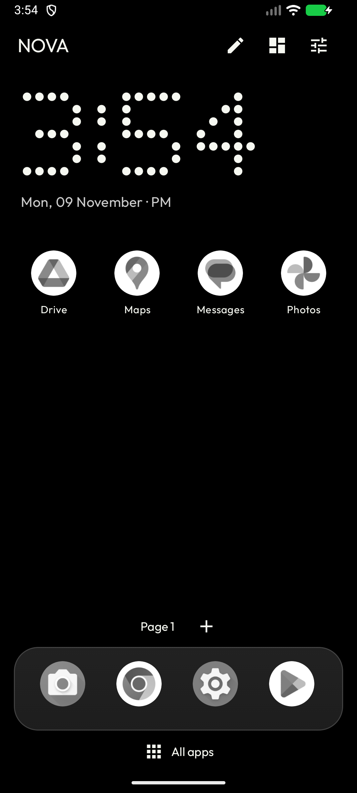
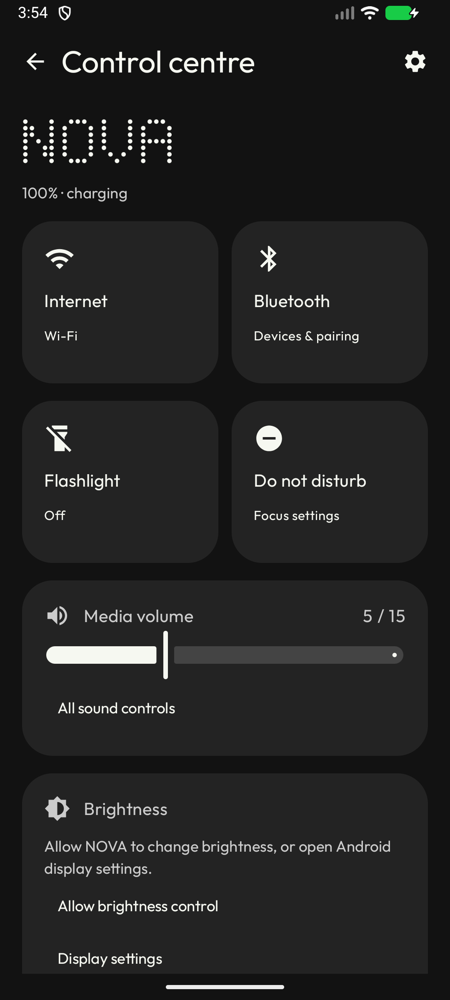
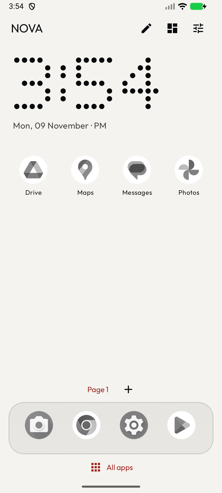

# NOVA

A Kotlin / Jetpack Compose smartphone launcher with Nothing OS-inspired monochrome styling, a dot-matrix clock, and a practical control centre. Independent project, inspired by CleanYourTV's minimalism; no affiliation with Nothing or other launcher vendors.

<p>



</p>

## Use it

Download `nova-debug` from a successful [Android CI run](https://github.com/aashleshshet/NOVA/actions/workflows/android.yml), unzip it, and open the APK on an Android phone. Android 8.0+ (API 26); compile/target API 36. Choose NOVA in **Settings → Apps → Default apps → Home app**, or use Studio's default-home button.

[Installation, rollback and troubleshooting](docs/INSTALL.md) · [Release notes](docs/RELEASE_NOTES.md) · [Validation evidence](docs/VALIDATION.md) · [Signed release guide](docs/SIGNING.md)

## Features

- Real installed apps, search, sorting, persistent pages/dock, folders and drag editing.
- AMOLED, dark, light and custom colors; lightweight glass dock, wallpaper, grayscale icons, grid/spacing/font/icon controls and live Studio preview.
- Control centre with actual battery/network status, media volume, flashlight and optional system brightness control. Internet, Bluetooth and DND use Android's settings panels.
- Android widgets with consent, configuration, ordered page positioning and resizing; compatible static ADW/Nova icon-pack mappings with default-icon fallback.
- Configurable home gestures; optional local suggestions, separate usage-access consent, reset and disable controls. Core features need no cloud API, root or ADB.
- Versioned JSON backup/restore. Device-bound widget IDs and usage history/consent are deliberately excluded.

## Build and test

Use JDK 17, Android SDK 36, Build Tools 36.1.0. Set `ANDROID_HOME` or untracked `local.properties` (`sdk.dir=...`).

```sh
./gradlew :core:test :app:testDebugUnitTest :app:lintDebug :app:assembleDebug :app:assembleDebugAndroidTest
./gradlew :app:connectedDebugAndroidTest  # emulator or dedicated test device
```

Debug APK: `app/build/outputs/apk/debug/app-debug.apk`. CI uploads it and reports. 20 Android/Compose tests pass on API 29/35 in GitHub CI and API 36.1 locally; 16 core JVM tests pass. See the linked validation record for exact runs and scope. Physical-device validation remains pending.

`:core` contains versioned state, validation, layout operations and suggestion ranking. `:app` contains Compose UI, DataStore and public Android integrations. [Architecture](docs/ARCHITECTURE.md), [reference/license audit](docs/REPOSITORY_AUDIT.md), [phase log](docs/PHASES.md), [icon-pack limits](docs/ICON_PACKS.md), [privacy](docs/PRIVACY.md), [design](DESIGN.md).
